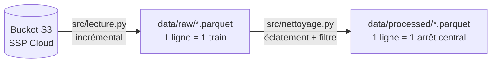

# Pipeline de données (RER A, B, D & Incidents)

Ce pipeline récupère les données temps réel de l'API PRIM (Île-de-France Mobilités) depuis le bucket S3 du SSP Cloud et les prépare pour l'étude de l'effet domino dans le tunnel commun **RER B / RER D** (*Châtelet-Les Halles* – *Gare du Nord*), avec le tronçon central du **RER A** comme ligne témoin.



## Volumétrie et couverture (au 26/11/2026)

| Source | Brut (`data/raw/`) | Propre (`data/processed/`) | Période couverte |
| :--- | :--- | :--- | :--- |
| **RER A** *(témoin)* | 32 896 trajets (26,7 Mo) | 157 748 arrêts (6,5 Mo) | 02/10/2026 – 26/11/2026 |
| **RER B** *(tunnel)* | 28 288 trajets (25,8 Mo) | 280 532 arrêts (8,4 Mo) | 02/10/2026 – 26/11/2026 |
| **RER D** *(tunnel)* | 23 410 trajets (14,4 Mo) | 64 316 arrêts (2,9 Mo) | 07/10/2026 – 26/11/2026 |
| **Incidents** | 1 565 messages (0,1 Mo) | 1 565 messages (0,1 Mo) | 07/10/2026 – 26/11/2026 |

---

## Fil conducteur : transformation d'un trajet type

Pour visualiser le traitement de bout en bout, suivons un même train du **RER B** (`journey_id = ...00c4eeec`, le `02/10/2026`).

### Étape 1 : Ingestion incrémentale (`src/lecture.py`)

`update_all()` synchronise les partitions S3 vers `data/raw/`. Si un fichier local existe déjà, seule la dernière journée connue (potentiellement incomplète) est écrasée et remplacée par les données à jour.

À ce stade, **1 ligne de DataFrame = 1 train entier**. Tous ses arrêts sont imbriqués sous forme de liste JSON dans la colonne `stops` :

| date | journey_id | nb_stops | stops *(chaîne JSON contenant les 33 arrêts du trajet)* |
| :--- | :--- | :--- | :--- |
| `2026-10-02` | `...00c4eeec` | `33` | `'[{"o":1,"n":"Lozère","ad":"05:22:47+00:00","dt":-5}, {"o":2,"n":"Le Guichet",...}, ..., {"o":17,"n":"Denfert-Rochereau","ad":"05:54:02+00:00","dt":-24}, ..., {"o":33,"n":"Mitry-Claye",...}]'` |

---

### Étape 2 : Restructuration et ciblage géographique (`charger_ligne` dans `src/nettoyage.py`)

DuckDB exécute les transformations suivantes avant de charger les données en mémoire :

* **Éclatement du JSON (`from_json` + `UNNEST`)** : déplie la liste `stops` pour passer de *1 ligne = 1 train* à *1 ligne = 1 passage en gare*, format indispensable pour suivre la propagation d'un retard d'une station à l'autre.
* **Ordonnancement chronologique (`stop_order` via `ROW_NUMBER`)** : trie les arrêts par horaire théorique (`aimed_time`) pour chaque train, permettant de reconstituer la séquence exacte et le sens de circulation (Nord/Sud).
* **Calcul du retard local (`delay_added_sec` via `LAG`)** : mesure le retard gagné ou perdu entre deux arrêts consécutifs (`delay_sec(t) - delay_sec(t-1)`). *Utilité :* isole la congestion propre au tunnel sans qu'elle soit biaisée par des retards accumulés plus tôt en banlieue.
* **Filtrage sur les tronçons centraux (`GARES_CENTRALES`)** : écarte les branches périphériques pour concentrer l'analyse sur le goulot d'étranglement B/D et ses gares encadrantes (12 gares pour le RER B, 5 pour le RER D), tout en conservant le tronçon central du RER A (5 gares) comme référence à haute fréquence sans partage de voies.
* **Normalisation et fuseau horaire** : uniformise l'écriture de `Châtelet-Les Halles` (évite de scinder le nœud d'interconnexion lors des agrégations) et convertit les horaires d'UTC vers `Europe/Paris`.

Les **33 arrêts** initiaux du train deviennent **12 lignes de DataFrame** (de Denfert-Rochereau à Aulnay-sous-Bois) :

| stop_order | stop_name | aimed_time *(Paris)* | delay_sec | delay_added_sec |
| :--- | :--- | :--- | :--- | :--- |
| 17 | Denfert-Rochereau | 2026-10-02 07:54:02+02:00 | -24 | -15 |
| 21 | Châtelet-Les Halles | 2026-10-02 08:02:00+02:00 | 68 | +19 |
| 22 | Gare du Nord | 2026-10-02 08:06:00+02:00 | 104 | +36 |
| ... | ... | ... | ... | ... |
| 28 | Aulnay-sous-Bois | 2026-10-02 08:24:10+02:00 | 164 | +6 |

---

### Étape 3 : Nettoyage statistique et variables métier (`ajout_variables` dans `src/nettoyage.py`)

Pandas applique ensuite les règles métier et exporte les tables finales dans `data/processed/` :

* **Filtrage des anomalies (`retard_min` dans `[-15, 180]`)** : convertit le retard en minutes et supprime les valeurs aberrantes (erreurs de capteurs ou trains fantômes) qui fausseraient les moyennes et quantiles (P90/P95).
* **Indicateurs d'exploitation (`est_supprime`, `zone_tunnel`)** : repère les trains annulés (`status == "CANCELLED"`) pour quantifier les suppressions en situation perturbée, et identifie les deux gares clés du tunnel (`Châtelet-Les Halles` et `Gare du Nord`).
* **Segmentation temporelle (`heure_pointe`, `tranche_horaire`)** : distingue les heures de pointe en semaine (`07h30–09h30` et `17h00–19h30`) des heures creuses, soirées et week-ends afin de mesurer l'effet de la saturation du trafic sur la contagion des retards.

| stop_name | retard_min | est_supprime | zone_tunnel | heure_pointe | tranche_horaire |
| :--- | :--- | :--- | :--- | :--- | :--- |
| Denfert-Rochereau | -0.40 | False | False | True | Pointe matin |
| Châtelet-Les Halles | 1.13 | False | True | True | Pointe matin |
| Gare du Nord | 1.73 | False | True | True | Pointe matin |
| ... | ... | ... | ... | ... | ... |
| Aulnay-sous-Bois | 2.73 | False | False | True | Pointe matin |

*(Les messages d'incidents suivent le même circuit et sont simplement filtrés à partir du `2026-10-02` pour être croisés avec les pics de retard.)*

---

## Utilisation

Pour charger directement les 4 tables propres dans un notebook ou l'application Streamlit (les fichiers sont générés automatiquement depuis `data/raw/` ou S3 s'ils sont absents) :

```python
from src.nettoyage import charger_donnees_propres

# Passer maj=True pour forcer la synchronisation avec S3
df_rer_a, df_rer_b, df_rer_d, df_incidents = charger_donnees_propres(source="local", maj=False)
```